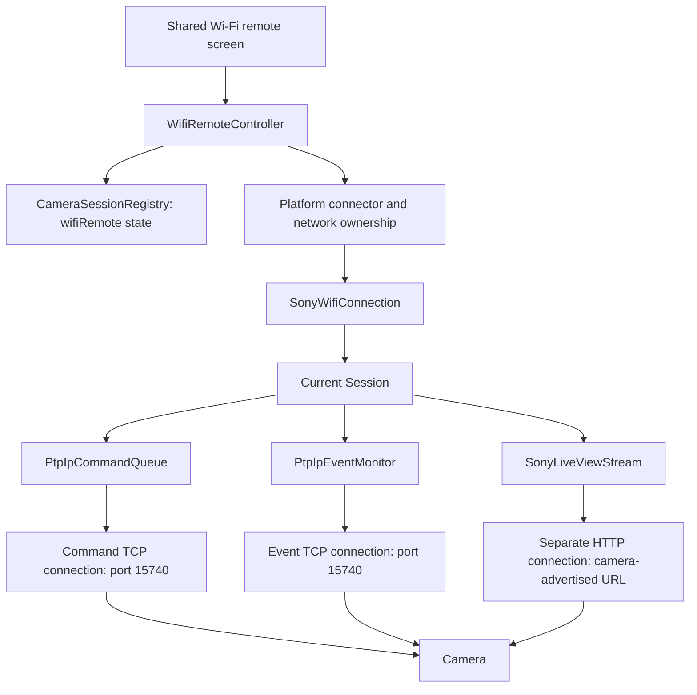
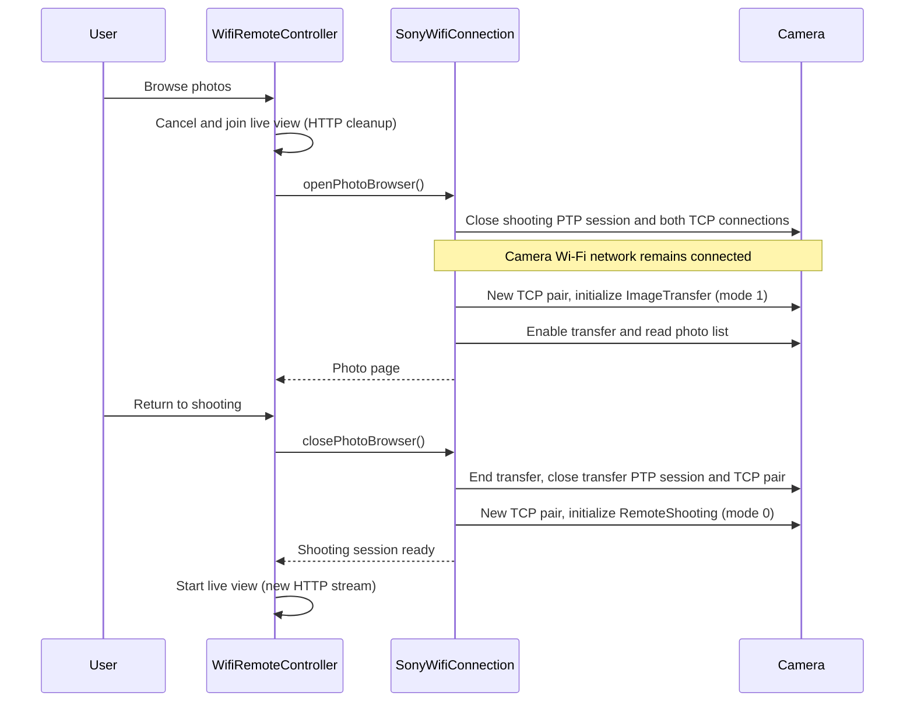

# Wi-Fi architecture

Alpha GPS uses Wi-Fi for live view, remote capture, and downloading photos. The phone joins the
camera's Wi-Fi network, opens a control connection to the camera, and opens a separate HTTP stream
for live-view images. Bluetooth can help start the camera's Wi-Fi and obtain its credentials; it
does not carry the images.

This guide follows the implementation in this checkout, including the capability-based switch to a
separate transfer session. Start with the session definitions below, then follow the connection and
browsing walkthroughs. Protocol bytes and reverse-engineering sources belong in
the [protocol evidence](wifi-remote-protocol-evidence.md).

- [What a session means](#what-a-session-means)
- [How the pieces fit together](#how-the-pieces-fit-together)
- [Connecting to a camera](#connecting-to-a-camera)
- [Opening the PTP session](#opening-the-ptp-session)
- [Live view and capture](#live-view-and-capture)
- [Browsing and switching sessions](#browsing-and-switching-sessions)
- [Downloading and saving](#downloading-and-saving)
- [Coroutines and threads](#coroutines-and-threads)
- [Disconnecting and handling failures](#disconnecting-and-handling-failures)
- [Where to read or change the code](#where-to-read-or-change-the-code)

## What a session means

PTP means Picture Transfer Protocol; PTP/IP carries it over a network. TCP is the underlying
reliable byte connection. The app opens multiple TCP connections to one camera, without joining
multiple Wi-Fi networks.

Several objects use the word “session”, but they have different lifetimes:

| Concept                                       | Meaning in this app                                                                                                                                                                | Lifetime                                                                                 |
|-----------------------------------------------|------------------------------------------------------------------------------------------------------------------------------------------------------------------------------------|------------------------------------------------------------------------------------------|
| `CameraSession`                               | The per-camera state record in `CameraSessionRegistry`, including `wifiRemote`. It is data for the UI and coordinators, not a socket.                                              | Can exist before, during, and after a Wi-Fi connection.                                  |
| Controller Wi-Fi session                      | One connect attempt and its work, owned by `WifiRemoteController.runSession()`.                                                                                                    | From Connect until failure or disconnect cleanup completes.                              |
| Camera network ownership                      | The OS network request and/or network-loss monitoring.                                                                                                                             | Kept while the Wi-Fi operation needs the camera network, including PTP session switches. |
| `SonyWifiConnection`                          | The implementation behind the `WifiRemoteConnection` interface, created in `SonyWifiSession.kt`. It holds the current protocol session and exposes capture, preview, and browsing. | One instance for the controller's connection.                                            |
| Private `Session` inside `SonyWifiConnection` | The current PTP connection pair, Sony capabilities, and feature helpers.                                                                                                           | Replaced when an older camera needs a different shooting/transfer mode.                  |
| PTP protocol session                          | The camera-side state opened by `OpenSession` or Sony's `SDIO_OpenSession`, after the TCP handshakes.                                                                              | Closed before replacing the PTP connections or ending the Wi-Fi operation.               |
| `sessionScope`                                | A coroutine lifetime, not a protocol command or network connection. This name occurs in both the controller and connection code.                                                   | Cancelling it stops its child jobs; cleanup must still close external resources.         |

**A session switch for browsing keeps the camera's Wi-Fi network connected.** It closes the old PTP
session and TCP connections, then opens replacements on that same network. There are no simultaneous
shooting and transfer PTP sessions in this flow.

## How the pieces fit together



The command connection carries requests, replies, and photo-download data. The event connection
receives notifications such as capture completion. Both are parts of one PTP/IP connection pair.
HTTP carries the live-view image stream. An HTTP connection is not another PTP session.

The shared code owns ordering, state, and Sony protocol decisions. Platform code provides network
access, byte I/O, image decoding where needed, and saving to the phone's photo library. These pieces
are manually wired in
[AndroidWifiRemote][android-wifi] and [IosWifiRemote][ios-wifi].

## Connecting to a camera

The platform app graph owns one [WifiRemoteController][controller]. Android's
`AppServices` creates it; iOS's `IosBluetoothController` creates it. The shared
[Wi-Fi screen][screen] calls this controller through its platform host. The controller allows one
Wi-Fi camera operation at a time and keeps ownership until cleanup finishes, so a new attempt cannot
overlap a closing connection.

There are three entry paths:

| Entry point                                                   | What happens before opening PTP                                                                                                                                                                  |
|---------------------------------------------------------------|--------------------------------------------------------------------------------------------------------------------------------------------------------------------------------------------------|
| `connectAutomatically()`                                      | BLE prepares the camera and reads credentials; the OS joins its Wi-Fi; the connector discovers its gateway address. Available on Android 10+ and iOS.                                            |
| `prepareManualConnection()` then `continueManualConnection()` | On Android 8–9, BLE obtains credentials, the user joins in Settings, and the connector verifies the joined network before opening PTP.                                                           |
| `connect(identifier, host)`                                   | The user has already enabled remote shooting and joined the camera's Wi-Fi. Android can discover the address when the host is blank; iOS's direct manual connector requires an explicit address. |

For automatic setup, [SonyWifiBootstrap][bootstrap] uses the existing BLE operation queue to start
Wi-Fi and read the SSID/password, with optional BSSID and status
reads. [AutomaticWifiRemoteConnector][automatic] then owns the OS network request. An available
network is not yet sufficient: it waits for a usable camera address before opening the camera
connection.

Android selects the camera Wi-Fi `Network` and uses its `socketFactory` for both PTP and HTTP. This
keeps camera traffic on that network even when mobile data is also available. Gateway discovery uses
that network's routes, not a hard-coded camera IP. iOS automatic setup uses
`NEHotspotConfiguration`, checks the expected SSID, and discovers a gateway through a Wi-Fi path
monitor.

The controller claims BLE remote controls before connecting: existing BLE shutter sequences and
remote probes finish cancellation so they do not compete with Wi-Fi shooting. This claim does not
itself shut down BLE or the GPS sender. Controls are released after Wi-Fi cleanup.

Typical automatic progress is:

```text
PreparingCamera → AwaitingNetworkApproval → JoiningNetwork → OpeningSession → Ready
```

Manual entry skips the steps it does not need. `Ready` means the protocol connection opened; live
view has its own `Waiting`, `Streaming`, or `Failed`
status. Being connected does not guarantee that the camera supports every feature.

## Opening the PTP session

[PtpIpSessionOpener][opener] establishes transport first:

1. Open the command TCP connection and send the PTP/IP command handshake.
2. Receive the camera's connection number.
3. Open the event TCP connection and attach it using that number.
4. Construct `PtpIpOpenedSession`, its command queue, and its event monitor.

All PTP commands pass through [PtpIpCommandQueue][queue], which executes one transaction at a time.
A transaction is one command, its optional data, and its response, matched by a transaction ID. The
caller suspends waiting for its result; the queue worker performs the I/O. This is a separate queue
from the BLE operation queue. The event monitor reads the other socket independently, so capture
events can arrive while a command is waiting for its response.

TCP reads return arbitrary chunks of bytes, not complete commands or images.
`CameraPtpIpConnection` and `PtpIpPacketCodec` reconstruct PTP packets from those chunks. The HTTP
and live-view decoders perform the equivalent framing work for preview data. These parsing loops are
separate from the platform socket-read loop.

[SonyPtpInitializer][initializer] then establishes the camera-side protocol state:

1. Read `GetDeviceInfo` to discover supported operations.
2. Read the device-description XML (DD) and digital-imaging-description XML (DID)
   through PTP if advertised. These contain endpoint/version/capability information.
3. Select and open the appropriate session mode.
4. Perform Sony's ordered connection handshake and read extended capabilities.
5. For a separate transfer session, read `GetDeviceInfo` again: transfer operations may only become
   visible after entering that mode.

Mode selection is capability-based, not a camera-model name check:

| Advertised capabilities                                                            | Open operation                                              | Browsing behavior                                                              |
|------------------------------------------------------------------------------------|-------------------------------------------------------------|--------------------------------------------------------------------------------|
| DID server major version 4 or newer                                                | Sony `0x9210 [1, 2]`: combined remote shooting and transfer | Keep the PTP session while browsing.                                           |
| DID major version 3, explicit media-server `Enable`, and Sony open-session support | Sony `0x9210 [1, 0]` for shooting; `[1, 1]` for transfer    | Replace the PTP session when entering/leaving browsing.                        |
| Neither selection above                                                            | Standard `0x1002 [1]`                                       | Keep the session; offer browsing only if its advertised operations support it. |

The DID server version is a protocol capability value, **not the camera firmware version**. The `1`
in these open commands is the PTP session ID; the second Sony parameter selects the mode. It is
unrelated to the handshake's connection number.

The modern combined mode remains preferred. The separate mode is a compatibility path, and still
requires usable transfer operations after initialization. Currently DD/DID discovery is through PTP
only; there is no SSDP/HTTP description discovery or DLNA browsing backend. The ZV-1's actual
behavior needs hardware confirmation; the existence of a Sony phone-transfer feature alone does not
prove that this PTP path applies to it.

## Live view and capture

The controller starts `previewJob`, which collects `connection.images`.
[SonyLiveViewEndpointResolver][endpoint] first tries the DD live-view URL, then the camera's
live-view property. URLs must refer to the camera peer.

[SonyLiveViewStream][liveview] enables the advertised modern preview controls when required, opens
the HTTP stream, and feeds received bytes into
`SonyLiveViewFrameDecoder`. That decoder extracts frames from Sony's framing; image decoding then
produces the `ImageBitmap` displayed by Compose. A one-frame buffer drops older waiting frames so
the preview does not accumulate a backlog. Legacy sessions skip the modern preview-enable controls.

Cancelling `previewJob` closes the HTTP stream and releases the preview controls in `finally`. **It
leaves PTP open** so the app can browse photos or start another preview. The active HTTP
implementation is [CameraHttpTransport][http] over
`CameraByteConnection`; Android's factory supplies `AndroidCameraHttpTransport`. The separate
`AndroidSonyLiveViewHttpTransport` class is not the transport wired by the current Android
connector.

Capture follows a different path: controller → [SonyPtpShutter][shutter] → PTP command queue. It
presses and releases the shutter controls and subscribes for capture completion before the full
press. Acceptance of a command is not proof that a photo completed. Missing confirmation produces
`Uncertain`, and the app does not automatically retry a shutter command that may already have fired.

## Browsing and switching sessions

The entry point is `WifiRemoteController.browsePhotos()`. It calls
`previewJob.cancelAndJoin()` before `connection.openPhotoBrowser()`: the old preview's cleanup must
finish before changing camera mode. Capture is also blocked while browsing.

For a modern combined session, `openPhotoBrowser()` uses the existing
`SonyImageTransfer`. Returning disables browser transfer mode and restarts the HTTP preview on the
same PTP connections. “Combined” describes protocol support; our UI still pauses live view while
browsing.

For the separate-session path, the flow is:



The actual replacement lives in `SonyWifiConnection.replaceSession()` in
[SonyWifiSession.kt][sony-session]. It detaches the old loss monitor, closes the previous session,
opens and initializes a new pair, then installs a fresh runtime and loss monitor. Detaching matters:
an intentionally closed event socket must not be interpreted as unexpected loss of the whole camera
connection.

Each replacement gets fresh command transaction IDs, capability information, and feature helpers.
Photo handles identify objects in the current camera session; they must not be assumed stable across
mode switches. Saved-download markers are therefore cleared when leaving a separate transfer
session.

A failed switch is reported through the browser's failure state. The app does not resume live view
until reopening shooting succeeds. Retry/return can attempt the transition again. Disconnecting from
the browser uses
`prepareToDisconnect()`, which ends transfer without needlessly reopening shooting.

## Downloading and saving

[SonyImageTransfer][transfer] selects the supported browsing implementation:
Sony's content catalog where advertised, otherwise the storage/object-handle path. The latter reads
object metadata using `GetObjectInfo`, or MTP's
`GetObjectPropList` if that is what the camera advertises. MTP here is a set of media-transfer
operations carried over the PTP/IP connection; it does not mean another HTTP stream.

A download revalidates metadata and reads the photo in chunks through the PTP command queue. It
writes those chunks to the platform's `CameraImageDestination`. The destination contract is
deliberately split:

```text
write(bytes), repeatedly → prepare() → cancellation check → commit()
                                  failure/cancellation → abort()
```

- `write()` stores incoming bytes.
- `prepare()` finishes any preparation, such as HEIF-to-JPEG conversion.
- `commit()` finishes publishing the completed photo to the phone's library.
- `abort()` removes incomplete output; it does not remove a successfully committed photo.

On modern Android, the photo is written into a pending MediaStore entry. Commit closes the stream
and clears `IS_PENDING`, exposing that same file to the gallery. Older Android uses a temporary file
followed by rename and a media scan. On iOS, the app imports a temporary file into Photos, awaits
success, then deletes the temporary file. Conversion adds temporary files that are cleaned up
separately.

Once commit starts it runs inside `NonCancellable`, allowing the app to determine whether the save
succeeded and retain a completed photo. Cancellation is checked before that boundary. If
cancellation arrives during a successful commit, that photo can still be reported as saved; the
batch checks cancellation before starting the next photo.

## Coroutines and threads

A scope groups work by lifetime. A dispatcher decides where work executes. Neither a new scope nor
`launch` implies a new dedicated thread.

```text
App scope (Main.immediate)
└── Controller runSession job
    ├── Connection-loss watcher
    ├── Capture request consumer
    ├── Preview job (while shooting)
    └── Photo work / photo preview jobs (while browsing)

SonyWifiConnection protocolScope (same dispatcher, independent SupervisorJob)
├── Current protocol Session scope
│   ├── PTP command worker
│   └── PTP event worker and session-close watcher
└── Current session loss monitor
```

The second scope deliberately survives cancellation of the controller job. Cleanup still needs a
working command queue to release controls and send
`CloseSession`. `SonyWifiConnection.close()` explicitly cancels this scope after closing the current
protocol session. Its `SupervisorJob` is not a background thread and is not permission to let work
outlive the connection indefinitely.

| Work                                                       | Where it executes or waits                                                                   |
|------------------------------------------------------------|----------------------------------------------------------------------------------------------|
| Shared session state, queue coordination, UI state updates | `Main.immediate`; callbacks deliver results into channels/flows.                             |
| Android socket reads/writes and file I/O                   | `Dispatchers.IO`; blocking Java calls occupy a worker while the caller suspends.             |
| iOS TCP I/O                                                | Network.framework callbacks feed channels; `receive()` suspends the coroutine while waiting. |
| Frame and photo decoding                                   | `Dispatchers.Default`; Android HEIF conversion currently uses IO.                            |
| iOS temporary-file preparation                             | `Dispatchers.Default`.                                                                       |

`delay`, channel waits, and other cancellable suspension points normally notice cancellation
themselves. Android's blocking `InputStream.read()` does not. Its adapter uses a one-second read
timeout and checks cancellation before retrying:

```kotlin
// Simplified from AndroidCameraByteConnection.read().
withContext(Dispatchers.IO) {
    while (true) {
        currentCoroutineContext().ensureActive()
        val count = try {
            input.read(buffer)
        } catch (_: SocketTimeoutException) {
            continue
        }
        // Return bytes, or end-of-stream when count == -1.
        break
    }
}
```

The check throws if the job was cancelled. It does not interrupt a read already in progress; the
socket timeout bounds the wait before the next check. This is why cancelling and joining preview can
wait for the blocking read to return. Other useful checkpoints are between native conversion stages,
before entering non-cancellable commit, and in error handlers that must distinguish intentional
cancellation from failure. A `suspend` function declaration alone does not guarantee that its
implementation checks cancellation.

## Disconnecting and handling failures

`disconnect()` sets the controller state to `Closing` and cancels its top-level job. The coroutine
hierarchy stops preview, photo work, and capture handling; their `finally` blocks run before the
outer connection cleanup finishes.
`closeAndJoin()` additionally waits for that cleanup, when a caller needs the resources fully
released before proceeding.

The outer cleanup uses `NonCancellable` so a user cancellation cannot skip it:

1. End browser transfer mode when appropriate, without reopening shooting.
2. On an explicit disconnect without an earlier connection failure, attempt the supported camera
   Wi-Fi shutdown command. The result may be unavailable or unconfirmed.
3. Close the Sony/PTP session, stop its queue/event monitor, and close both sockets.
4. Cancel the protocol scope and release platform monitoring/network ownership. The automatic
   connector releases its OS network request after the camera connection closes.
5. Clear images, release BLE remote controls, and publish `Idle` or `Failed`.

Stopping live view alone performs only preview cleanup. Switching a PTP session performs protocol
cleanup but retains network ownership. Full disconnect releases all of these layers. Releasing an OS
request does not guarantee that every manually joined network is disconnected or that the camera has
powered Wi-Fi off.

Connection failures and feature failures are distinct. An unexpected network or PTP event-channel
loss ends the connection; a failed preview can leave capture available. Browser/transfer errors stay
in their feature state so the user can retry or return. Shutter timeouts remain uncertain rather
than prompting a blind retry.

Per-camera connection and feature state lives in `CameraSession.wifiRemote` using
[WifiRemoteState][state]. Large image payloads live in the controller's separate
`image`, `thumbnails`, and `photoPreview` flows. This keeps the registry focused on state rather
than carrying a new bitmap on every preview frame.

## Where to read or change the code

Read the first three rows in order for the ownership story; follow the feature helpers only when
investigating that feature.

| Question                                                      | Starting point                                                                                                                            |
|---------------------------------------------------------------|-------------------------------------------------------------------------------------------------------------------------------------------|
| Who owns Connect, Browse, Back, Disconnect, and UI state?     | [WifiRemoteController][controller]: `runSession`, `browsePhotos`, `leavePhotoBrowser`.                                                    |
| What stays alive when we switch modes?                        | [SonyWifiSession][sony-session]: `SonyWifiConnection`, private `Session`, `replaceSession`, `close`.                                      |
| What opens the sockets versus the camera protocol session?    | [PtpIpSessionOpener][opener], then [SonyPtpInitializer][initializer].                                                                     |
| How do requests stay ordered and responses find their caller? | [PtpIpCommandQueue][queue]: one worker, transaction IDs, deferred results; [PtpIpEventMonitor][events] for asynchronous events.           |
| How does the phone join camera Wi-Fi?                         | [AutomaticWifiRemoteConnector][automatic], then [AndroidCameraNetworkRequest][android-network] or [IosCameraNetworkRequest][ios-network]. |
| Where does live view start/stop?                              | [SonyLiveViewStream][liveview] and [CameraHttpTransport][http].                                                                           |
| Why is a shutter command accepted but the UI uncertain?       | [SonyPtpShutter][shutter] and its capture-event wait.                                                                                     |
| Which browsing operations are supported?                      | [SonyImageTransfer][transfer], [SonyContentCatalog][catalog], [SonyMtpObjectInfo][mtp].                                                   |
| Where are native sockets and gallery saves?                   | [Android platform files][android-dir] and [iOS platform files][ios-dir].                                                                  |

The [shared Wi-Fi tests][tests] are useful executable examples.
`SonyWifiSessionTest` covers session replacement, cancellation, and preserving network ownership;
`WifiRemoteControllerTest` covers UI-facing lifetimes;
`SonyPtpInitializerTest` covers mode selection; `SonyLiveViewStreamTest` covers preview control
cleanup; and `SonyImageTransferTest` covers download behavior. The Android camera simulator
currently covers remote/live-view flows, not gallery browsing/downloads. Fake-protocol tests do not
establish real-camera compatibility.

For on-device investigation, use the [Android testing guide](wifi-remote-android-testing.md). Useful
log stages are `Wi-Fi remote attempt=…`, `Wi-Fi PTP switching to …`,
`Wi-Fi Sony stage=…`, and `Wi-Fi live view …`: they identify the ownership, session-selection,
initialization, and preview layers respectively.

[controller]: ../sharednew/src/commonMain/kotlin/com/sasch/cameragps/sharednew/remote/wifi/WifiRemoteController.kt
[sony-session]: ../sharednew/src/commonMain/kotlin/com/sasch/cameragps/sharednew/remote/wifi/SonyWifiSession.kt
[opener]: ../sharednew/src/commonMain/kotlin/com/sasch/cameragps/sharednew/remote/wifi/PtpIpSessionOpener.kt
[initializer]: ../sharednew/src/commonMain/kotlin/com/sasch/cameragps/sharednew/remote/wifi/SonyPtpInitializer.kt
[queue]: ../sharednew/src/commonMain/kotlin/com/sasch/cameragps/sharednew/remote/wifi/PtpIpCommandQueue.kt
[events]: ../sharednew/src/commonMain/kotlin/com/sasch/cameragps/sharednew/remote/wifi/PtpIpEventMonitor.kt
[automatic]: ../sharednew/src/commonMain/kotlin/com/sasch/cameragps/sharednew/remote/wifi/AutomaticWifiRemoteConnector.kt
[bootstrap]: ../sharednew/src/commonMain/kotlin/com/sasch/cameragps/sharednew/remote/wifi/SonyWifiBootstrap.kt
[liveview]: ../sharednew/src/commonMain/kotlin/com/sasch/cameragps/sharednew/remote/wifi/SonyLiveViewStream.kt
[endpoint]: ../sharednew/src/commonMain/kotlin/com/sasch/cameragps/sharednew/remote/wifi/SonyLiveViewEndpointResolver.kt
[http]: ../sharednew/src/commonMain/kotlin/com/sasch/cameragps/sharednew/remote/wifi/CameraHttpTransport.kt
[shutter]: ../sharednew/src/commonMain/kotlin/com/sasch/cameragps/sharednew/remote/wifi/SonyPtpShutter.kt
[transfer]: ../sharednew/src/commonMain/kotlin/com/sasch/cameragps/sharednew/remote/wifi/SonyImageTransfer.kt
[catalog]: ../sharednew/src/commonMain/kotlin/com/sasch/cameragps/sharednew/remote/wifi/SonyContentCatalog.kt
[mtp]: ../sharednew/src/commonMain/kotlin/com/sasch/cameragps/sharednew/remote/wifi/SonyMtpObjectInfo.kt
[state]: ../sharednew/src/commonMain/kotlin/com/sasch/cameragps/sharednew/remote/wifi/WifiRemoteState.kt
[screen]: ../sharednew/src/commonMain/kotlin/com/sasch/cameragps/sharednew/ui/remote/WifiRemoteScreen.kt
[android-wifi]: ../sharednew/src/androidMain/kotlin/com/sasch/cameragps/sharednew/remote/wifi/AndroidWifiRemote.kt
[ios-wifi]: ../sharednew/src/iosMain/kotlin/com/sasch/cameragps/sharednew/remote/wifi/IosWifiRemote.kt
[android-network]: ../sharednew/src/androidMain/kotlin/com/sasch/cameragps/sharednew/remote/wifi/AndroidCameraNetworkRequest.kt
[ios-network]: ../sharednew/src/iosMain/kotlin/com/sasch/cameragps/sharednew/remote/wifi/IosCameraNetworkRequest.kt
[android-dir]: ../sharednew/src/androidMain/kotlin/com/sasch/cameragps/sharednew/remote/wifi/
[ios-dir]: ../sharednew/src/iosMain/kotlin/com/sasch/cameragps/sharednew/remote/wifi/
[tests]: ../sharednew/src/commonTest/kotlin/com/sasch/cameragps/sharednew/remote/wifi/
